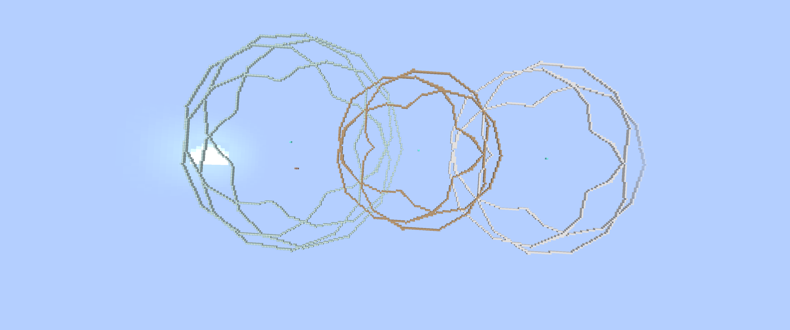
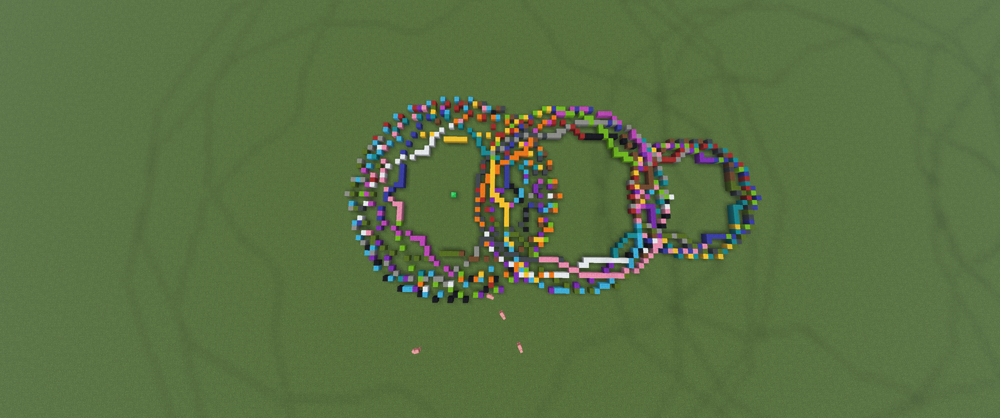

# Fourier / Spirograph Patterns

Draws spirograph-style curves in Minecraft, four patterns with different parameters.



## How it works

Each curve is a circle with a smaller circle riding on it, in the style of an epitrochoid:

$$x = (R + r)\cos t + p\cos\!\left(\tfrac{R + r}{r}\,t\right) \qquad z = (R + r)\sin t + p\sin\!\left(\tfrac{R + r}{r}\,t\right)$$

The script samples points along the curve, rounds each one to a block, and joins consecutive points with straight lines of blocks so the curve has no gaps.

| # | R | r | p | Points | Block | Ratio R/r |
|---|---|---|---|---|---|---|
| 1 | 25 | 15 | 12 | 800 | sea lantern | 5/3 |
| 2 | 28 | 16 | 8 | 900 | glowstone | 7/4 |
| 3 | 30 | 20 | 15 | 1200 | ochre froglight | 3/2 |
| 4 | 24 | 18 | 10 | 1000 | pearlescent froglight | 4/3 |

The ratio $R/r$ (in lowest terms, $a/b$) decides the shape: the curve has $a$ lobes and closes after $b$ turns.

The script waits for you to press Enter between patterns, and later patterns draw over earlier ones.

## The hard part

The math was not too bad. The hard part was fitting it to Minecraft's grid, because a block is 1 × 1 × 1 and a curve is infinitely thin. If two loops come closer than one block, they merge into a solid mass. The first attempt was unreadable for that reason, and the fix was scaling up the radii and tuning the step size. The full story is in [`grid-resolution-problem.md`](grid-resolution-problem.md).

| First attempt | After scaling to the grid |
|---|---|
|  |  |

## Run it

```bash
python fourier_patterns.py
```

The script uses only the standard library. The password is in `MinecraftRCON.__init__`. The froglight blocks need Minecraft 1.19 or newer. See the [main README](../README.md#setup) for the RCON setup.

## Files

- `fourier_patterns.py`: the generator
- `grid-resolution-problem.md`: the write-up on fitting curves to a block grid
- `FirstTryFourier.png`, `FourierSuccess.png`: before and after screenshots
