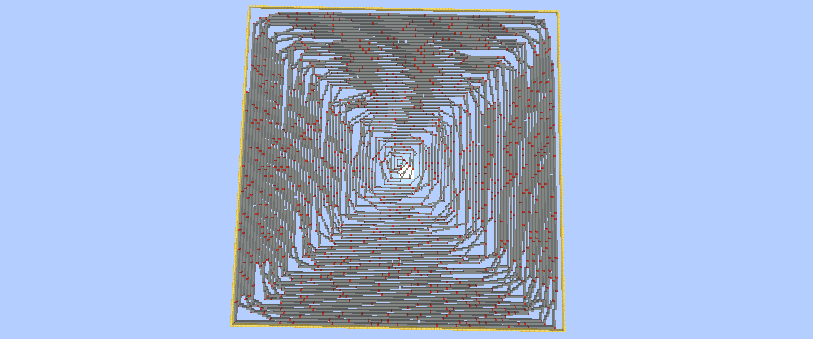

# Ulam Spiral

Draws the Ulam spiral in Minecraft: write the positive integers in a square spiral, then highlight the primes.



## How it works

1. The numbers 1 to 10,000 (`SPIRAL_SIZE = 100`, so 100 × 100) are laid out in a clockwise square spiral. Each number gets an `(x, z)` position.
2. `is_prime` finds the primes by trial division. It checks 2 and 3, then only numbers of the form 6k ± 1 up to $\sqrt{n}$.
3. Every position is stretched by `SCALE = 2`, so the picture is 200 × 200 blocks.
4. Consecutive primes are joined by lines of light gray concrete. The primes themselves are redstone blocks. A gold block border surrounds the whole thing and a sign marks the spiral.

There are 1,229 primes below 10,000 (12.29%). The largest is 9,973.

## Run it

```bash
python ulam.py
```

The script uses only the standard library. The password is in `MinecraftRCON.__init__`. See the [main README](../README.md#setup) for the RCON setup.

The sign uses the older `Text1`–`Text4` format, so on Minecraft 1.20 or newer the sign text may not show. The spiral itself still draws.

## Files

- `ulam.py`: the generator
- `explanation.md`: how the spiral is built and how primes are detected, with worked examples
- `UlamVisual.png`: a screenshot of the result
