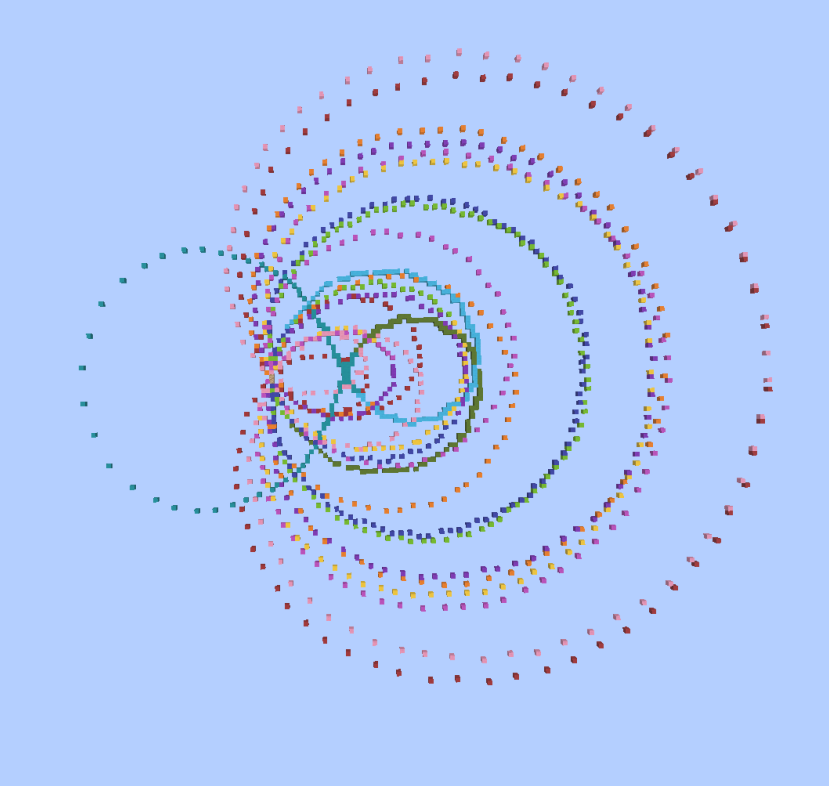

# Riemann Zeta Function on the Critical Line

Plots the path of $\zeta(\tfrac{1}{2} + it)$ for $t$ from −50 to 50 as a line of colored blocks. The nontrivial zeros of the zeta function sit on this line, so the path passes through the origin at each zero.



## How it works

- The input $s = \tfrac{1}{2} + it$ is a complex number. The output $\zeta(s)$ is also a complex number, so the script uses its real part as the Minecraft `x` coordinate and its imaginary part as `z`, both multiplied by `scale = 30`.
- 1,500 values of $t$ are sampled evenly. The wool color changes from red to pink as $t$ goes from −50 to 50.
- Any sample where $|\zeta(s)| < 0.05$ is a glowstone block. These are samples *near* a zero, not exact zeros. There are 20 zeros with $|t| \le 50$, and the script flags 24 samples near them.

### Why the eta function?

The zeta series $\sum 1/n^s$ only converges when $\text{Re}(s) > 1$, and the critical line is $\text{Re}(s) = \tfrac12$. The Dirichlet eta function, its alternating version, converges for $\text{Re}(s) > 0$ and is related to zeta by

$$\zeta(s) = \frac{\eta(s)}{1 - 2^{1-s}}$$

`approx_zeta_via_eta` adds up the first 2,000 terms of $\eta(s)$ and divides by $1 - 2^{1-s}$. Checked against a high-precision library (`mpmath`) at several values of $t$ up to 50, it was within about 0.005 of the true value, which is well under the 0.05 zero threshold.

## Run it

```bash
pip install numpy rcon
python zetaxc.py
```

Set the server password in the `PASSWORD` variable at the bottom of the file. See the [main README](../README.md#setup) for the RCON setup.

## Files

- `zetaxc.py`: the plot
- `zeta-to-eta.md`: where the formula above comes from
- `analytic-continuation.md`: why extending zeta this way gives the same function and not a new one
- `visual.png`: a screenshot of the result
